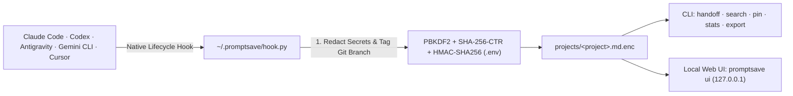

<div align="center">

# PromptSave

**Automatic, encrypted prompt history vault for terminal AI coding assistants.**

Capture every prompt across **Claude Code**, **OpenAI Codex CLI**, **Antigravity CLI**, **Gemini CLI**, and **Cursor** — with **`.env` encryption**, **automatic secret redaction**, **Git branch tagging**, **instant AI handoff**, and a **local web dashboard**.

[](LICENSE)
[](https://www.python.org/)
[](#)
[](#)
[](CHANGELOG.md)

[Installation](#installation) · [Quick Start](#quick-start) · [Key Features](#key-features) · [Commands](#command-reference) · [Supported Tools](#supported-ai-tools) · [Security](#security--privacy) · [FAQ](#faq)

</div>

---

## Why PromptSave?

When you build across multiple AI coding tools — or hit a rate limit in one and switch to another — your prompt history is scattered and lost the moment you close your terminal.

**PromptSave** hooks natively into all five major AI tools and turns your prompt history into a **private, local, searchable vault**:

- **Seamless AI Handoff (`promptsave handoff`)** — Switching from Claude Code to Codex or Cursor? Generate a clean chronological context brief from your last prompts and copy it straight to your clipboard in one command.
- **Encrypted & Redacted by Default** — Every installation generates a unique 256-bit key in `.env`. Accidentally pasted API keys, tokens, JWTs, or private keys are automatically scrubbed (`[REDACTED_...]`) before saving.
- **Git Branch & Commit Context** — Every prompt automatically records `branch @ short_sha` in pure Python (<1ms, no subprocess overhead).
- **Local Web Dashboard (`promptsave ui`)** — Browse, filter by AI tool, search across encrypted projects, pin favorites, and copy handoffs in a zero-dependency dark-mode localhost UI.
- **Reusable Prompt Pins (`promptsave pin` / `copy`)** — Save your best prompts under short tags and copy them to your clipboard in any project.
- **Zero Dependencies, 100% Offline** — Pure Python 3.8+ standard library. Never blocks your AI CLI.

---

## Installation

### Option 1 — Install with `pip` (Recommended)

```bash
pip install git+https://github.com/fkayhan11/promptsave.git
promptsave install
```

> Vault location defaults to `~/PromptSave/projects` (with your private key in `~/PromptSave/.env`).
> Want a custom folder? Run `promptsave install --center ~/Documents/PromptVault`.

### Option 2 — Install isolated with `pipx`

```bash
pipx install git+https://github.com/fkayhan11/promptsave.git
promptsave install
```

### Option 3 — Clone from source (editable or zero-install)

```bash
git clone https://github.com/fkayhan11/promptsave.git
cd promptsave

# Editable install (gives you the global `promptsave` command)
pip install -e .
promptsave install

# Or run directly without pip
python3 promptsave/install.py
```

---

## Quick Start

### 1. Track any project

```bash
cd /path/to/my-web-app
promptsave init
```

*(Prefer drag-and-drop? Copying the `promptsave/` folder into a project works identically.)*

### 2. Use your AI CLI normally

Open `claude`, `codex`, `agy`, `gemini`, or **Cursor** inside that project (or any subfolder). Untracked folders are silently ignored.

### 3. Browse, search, handoff, or launch the local UI

```bash
promptsave ui                                # Open localhost dark-mode dashboard
promptsave handoff my-web-app --last 10      # Copy context brief to switch AI tools
promptsave search "auth" --tool claude       # Search across all encrypted logs
promptsave pin my-web-app 4 --tag auth-fix   # Save a reusable prompt under a tag
promptsave copy auth-fix                     # Copy pinned prompt to clipboard
promptsave stats                             # View usage breakdown by AI tool & project
```

---

## Key Features

### Architecture



### Switching AI Tools with `promptsave handoff`

```text
$ promptsave handoff my-web-app --last 3
# Context Handoff — my-web-app

I am continuing work on `my-web-app` and switching AI coding assistants.
Here are my last 3 prompt(s) in chronological order so you have full context:

### 1. [Claude Code · 2026-11-24 03:10 · feat/auth @ 768ef97]
Scaffold a responsive login page with email/password validation.

### 2. [Codex · 2026-11-24 03:14 · feat/auth @ 768ef97]
Add unit tests for the login form validation rules.

Please acknowledge this context and wait for my next instruction.
(Copied handoff for 'my-web-app' — last 2 prompts — to clipboard!)
```

### Automatic Secret Redaction

If you accidentally paste a key or token into a prompt, PromptSave scrubs it before writing to disk:

- OpenAI / Anthropic / Stripe keys → `[REDACTED_OPENAI_KEY]`
- GitHub tokens & fine-grained PATs → `[REDACTED_GITHUB_TOKEN]` / `[REDACTED_GITHUB_PAT]`
- AWS Access Keys → `[REDACTED_AWS_KEY]`
- Google API keys, Slack tokens, JWTs, Bearer headers, and PEM Private Keys → `[REDACTED_...]`

---

## Supported AI Tools

| AI Tool | Lifecycle Event | Global Config Path | Notes |
| --- | --- | --- | --- |
| **Claude Code** | `UserPromptSubmit` | `~/.claude/settings.json` | Works immediately |
| **OpenAI Codex CLI** | `UserPromptSubmit` | `~/.codex/hooks.json` | Approve hook once on launch (`2. Trust all and continue` or `/hooks`) |
| **Antigravity CLI** | `PreInvocation` | `~/.gemini/config/hooks.json` | Auto-deduplicates multi-step tool turns |
| **Gemini CLI** | `BeforeAgent` | `~/.gemini/settings.json` | Returns `{"decision": "allow"}` |
| **Cursor** | `beforeSubmitPrompt` | `~/.cursor/hooks.json` | Returns `{"continue": true}`, strips Windows UTF-8 BOM |

---

## Command Reference

| Command | Description |
| --- | --- |
| `promptsave install [--center DIR]` | Register global hooks for all 5 AI CLIs and generate `.env` key |
| `promptsave status` | Show active hooks, vault path, encryption, redaction, and tracked count |
| `promptsave init [path]` | Create a `.promptsave` marker to start tracking a project |
| `promptsave ui [--port 8787]` | Launch the local dark-mode web dashboard (`127.0.0.1` only) |
| `promptsave handoff <project> [--last N]` | Build & copy a chronological context brief for switching AI CLIs |
| `promptsave list` | List all saved projects (`encrypted` / `plaintext`) |
| `promptsave view <project>` | Decrypt and print a project's prompt history to stdout |
| `promptsave search <query> [--tool T] [--project P]` | In-memory full-text search across all encrypted logs |
| `promptsave pin <project> <num> --tag <tag>` | Pin a reusable prompt under a short tag |
| `promptsave pins` | List all pinned prompts |
| `promptsave copy <tag>` | Print and copy a pinned prompt to clipboard |
| `promptsave unpin <tag>` | Remove a pinned prompt |
| `promptsave stats` | Display usage breakdown by AI tool and project with ASCII bars |
| `promptsave export <project> -f json\|md\|html [-o FILE]` | Export a project's prompts to JSON, Markdown, or dark-mode HTML |
| `promptsave unlock` / `lock` | Temporarily decrypt `.md.enc` → `.md` for editor browsing, then re-lock |
| `promptsave uninstall` | Remove all global CLI hooks (keeps your saved logs and `.env`) |

---

## Security & Privacy

PromptSave is built so **no user can ever access another user's prompts**:

- **Unique Key Per Installation:** `promptsave install` generates a random 256-bit `PROMPTSAVE_KEY` in `.env` (`0600` permissions). Only an empty `.env.example` exists in Git.
- **Authenticated Encryption (Encrypt-then-MAC):** Every write uses `PBKDF2-HMAC-SHA256` (200,000 iterations, random 16-byte salt), `SHA-256-CTR` (random 16-byte nonce), and `HMAC-SHA256` integrity verification. Wrong keys or tampered files are rejected immediately.
- **Secret Redaction:** Enabled by default (`PROMPTSAVE_REDACT=true`) to prevent secrets from entering your prompt archive.
- **Double Git Protection:** `.gitignore` excludes `.env`, `projects/*.md`, `projects/*.md.enc`, and `summary/README.md`.
- **100% Offline:** Zero network calls, zero telemetry. The web UI binds strictly to `127.0.0.1`.

---

## FAQ

<details>
<summary><strong>Can I disable encryption or secret redaction?</strong></summary>

Yes. Edit your `.env` file:

```env
PROMPTSAVE_ENCRYPT=false
PROMPTSAVE_REDACT=false
```

Plaintext logs remain gitignored by default.
</details>

<details>
<summary><strong>What happens if I lose my <code>.env</code> file?</strong></summary>

Because encryption is 100% local with no cloud recovery, `.md.enc` files cannot be decrypted without the matching `PROMPTSAVE_KEY`. Back up your `.env` in a password manager if you want long-term archives.
</details>

<details>
<summary><strong>Will PromptSave ever break or block my AI CLI?</strong></summary>

No. `hook.py` wraps execution in a fail-safe handler and always exits with code `0` (emitting the expected allow response for Antigravity, Gemini CLI, and Cursor).
</details>

<details>
<summary><strong>How do I upgrade PromptSave?</strong></summary>

```bash
pip install --upgrade git+https://github.com/fkayhan11/promptsave.git
promptsave install
```

Your existing `.env` key, pins, and saved logs are preserved automatically.
</details>

---

## Development & Tests

```bash
git clone https://github.com/fkayhan11/promptsave.git
cd promptsave
python3 -m unittest discover -s tests -v
```

Contributions are welcome — see [CONTRIBUTING.md](CONTRIBUTING.md).

## License

[MIT](LICENSE)
