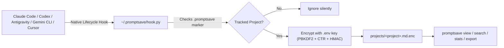

<div align="center">

# PromptSave

**Your private, encrypted prompt history vault for terminal AI coding assistants.**

[](LICENSE)
[](https://www.python.org/)
[](#)
[](#)
[](#supported-ai-tools)

[Features](#features) · [How It Works](#how-it-works) · [Quick Start](#quick-start) · [Vault CLI](#vault-cli) · [Security](#privacy--security) · [Contributing](CONTRIBUTING.md)

</div>

---

When you build projects across **Claude Code**, **OpenAI Codex CLI**, **Antigravity CLI**, **Gemini CLI**, and **Cursor**, your prompt history gets scattered across sessions and lost the moment you close a terminal.

**PromptSave** hooks natively into all five tools and automatically saves every prompt you write into **one central, encrypted vault** — organized by project, numbered `1, 2, 3, ...`, and searchable in milliseconds.

---

## Features

- **5 AI Tools, 1 Unified Vault** — Works simultaneously with **Claude Code**, **OpenAI Codex CLI**, **Antigravity CLI**, **Gemini CLI**, and **Cursor**.
- **Zero-Friction Project Tracking** — Run `promptsave init` inside any project (or simply drop the `promptsave/` folder in). Untracked folders are completely ignored.
- **Encrypted by Default (`.env`)** — Every installation generates a unique, local 256-bit `PROMPTSAVE_KEY` in `.env`. Logs are stored encrypted (`projects/<project>.md.enc`) using `PBKDF2-HMAC-SHA256` + `SHA-256-CTR` + `HMAC-SHA256`.
- **Search, Stats & Export** — Search across all encrypted projects without writing plaintext to disk, view usage breakdowns by AI tool, or export any project to **JSON**, **Markdown**, or **dark-mode HTML**.
- **100% Local & Zero Dependencies** — Pure Python 3.8+ standard library. No cloud, no telemetry, no `pip` dependencies, and never blocks your AI CLI.

---

## How It Works



---

## Supported AI Tools

| AI Tool | Hook Event | Global Config File |
| --- | --- | --- |
| **Claude Code** | `UserPromptSubmit` | `~/.claude/settings.json` |
| **OpenAI Codex CLI** | `UserPromptSubmit` | `~/.codex/hooks.json` |
| **Antigravity CLI** | `PreInvocation` | `~/.gemini/config/hooks.json` |
| **Gemini CLI** | `BeforeAgent` | `~/.gemini/settings.json` |
| **Cursor** | `beforeSubmitPrompt` | `~/.cursor/hooks.json` |

> **One-time Codex approval:** For security, Codex CLI asks you once to trust newly added hooks. The next time you open `codex`, select **`2. Trust all and continue`** (or run `/hooks`).

---

## Quick Start

### 1. Clone and install (once per machine)

```bash
git clone https://github.com/fkayhan11/promptsave.git
cd promptsave
python3 promptsave/install.py
```

*(Optional)* Install the global `promptsave` command so you can run it from anywhere:

```bash
pip install -e .
```

`install.py` automatically:
1. Generates a unique 256-bit `PROMPTSAVE_KEY` in `.env` (`chmod 600`, gitignored).
2. Registers the non-blocking hook across all 5 supported AI tools (backing up existing configs to `~/.promptsave/backups/`).

### 2. Track any project

Pick whichever workflow you prefer:

```bash
# Option A: One-command CLI init (creates a .promptsave marker)
cd /path/to/my-web-app
promptsave init

# Option B: Drop-in folder copy (works even without pip install)
cp -R /path/to/promptsave/promptsave /path/to/my-web-app/
```

That's it. Every prompt you type in `claude`, `codex`, `agy`, `gemini`, or Cursor inside that project (or any of its subdirectories) is automatically encrypted and appended to `projects/my-web-app.md.enc`.

---

## Vault CLI

Every command works via `promptsave <cmd>` (if installed with `pip install -e .`) or directly via `python3 promptsave/vault.py <cmd>`.

### View & List

```bash
promptsave list
promptsave view my-web-app
```

### Search Across Encrypted Logs

Decrypts purely in memory — never writes plaintext to disk:

```bash
promptsave search "auth" --tool claude
```

```text
[my-web-app #1] Claude Code · 2026-11-20 10:15
  Scaffold a responsive login page with email/password validation.

Found 1 matching prompt(s).
```

### Usage Statistics

```bash
promptsave stats
```

```text
PromptSave Statistics
================================================
Total projects : 3
Total prompts  : 24

By AI Tool:
  Claude Code      11  ####################
  Antigravity       7  #############
  Codex             4  #######
  Cursor            2  ####

By Project:
  my-web-app                14 prompt(s)
  ml-lab                     6 prompt(s)
  api-service                4 prompt(s)
```

### Export (JSON, Markdown, Dark-Mode HTML)

```bash
promptsave export my-web-app --format json --output my-web-app.json
promptsave export my-web-app --format html --output my-web-app.html
promptsave export my-web-app --format md   --output my-web-app.md
```

### Temporary Editor Browsing (`unlock` / `lock`)

```bash
# Temporarily decrypt projects/*.md.enc -> projects/*.md to browse in VS Code
promptsave unlock

# Re-encrypt and remove all plaintext .md copies when finished
promptsave lock
```

### Maintenance

```bash
promptsave status                    # Check active hooks, encryption mode, and tracked count
promptsave install --set-center      # Update central log path after moving the repo
promptsave uninstall                 # Remove global hooks (saved logs & .env are untouched)
```

---

## Privacy & Security

PromptSave is built so that **users who clone this repository can never see each other's prompts**:

| Layer | Protection |
| --- | --- |
| **Per-User Secret Key** | `install.py` generates a fresh 256-bit `PROMPTSAVE_KEY` locally in `.env` (`0600` permissions). Only `.env.example` exists in Git. |
| **Authenticated Encryption** | `PBKDF2-HMAC-SHA256` (200,000 iterations, random 16-byte salt) + `SHA-256-CTR` (random 16-byte nonce per write) + `HMAC-SHA256` (Encrypt-then-MAC). Wrong keys or tampered files are rejected immediately. |
| **Double Git Isolation** | `.gitignore` blocks `.env`, `projects/*.md`, `projects/*.md.enc`, and `summary/README.md` by default. |
| **Zero Telemetry** | 100% offline. No network requests, ever. |

> Prefer unencrypted local Markdown files? Set `PROMPTSAVE_ENCRYPT=false` in `.env` (files remain gitignored).

---

## Folder Structure

```text
promptsave/
├── .env.example           # Template for local encryption config
├── .env                   # Auto-generated local 256-bit key (gitignored)
├── projects/              # Per-project encrypted logs: <project>.md.enc (gitignored)
├── summary/               # Auto-generated overview table: README.md (gitignored)
├── promptsave/
│   ├── .promptsave        # Drop-in project marker
│   ├── cli.py             # Unified `promptsave` CLI entry point
│   ├── crypto.py          # Zero-dependency authenticated encryption
│   ├── hook.py            # Multi-CLI lifecycle hook handler
│   ├── install.py         # Global hook & .env installer
│   └── vault.py           # list, view, search, stats, export, unlock, lock
├── examples/              # Sanitized sample Markdown output
├── tests/                 # Unit test suite
└── pyproject.toml         # Standard Python packaging metadata
```

Runtime state files (`.lock`, `.state.json`, `.projects.json`, config backups) are kept out of sight in `~/.promptsave/`.

---

## Running Tests

```bash
python3 -m unittest discover -s tests -v
```

---

## Contributing & License

Contributions are welcome! See [CONTRIBUTING.md](CONTRIBUTING.md) for guidelines.
Licensed under the [MIT License](LICENSE).
