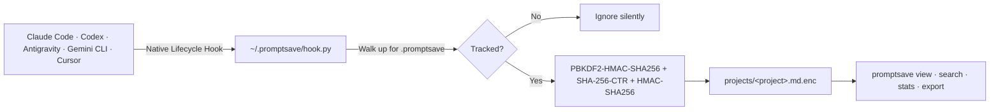

<div align="center">

# PromptSave

**Automatic, encrypted prompt history vault for terminal AI coding assistants.**

Capture every prompt you write across **Claude Code**, **OpenAI Codex CLI**, **Antigravity CLI**, **Gemini CLI**, and **Cursor** into one private, searchable, project-organized vault.

[](LICENSE)
[](https://www.python.org/)
[](#)
[](#)
[](CHANGELOG.md)

[Installation](#installation) · [Quick Start](#quick-start) · [Commands](#command-reference) · [Supported Tools](#supported-ai-tools) · [Security](#security--privacy) · [FAQ](#faq)

</div>

---

## Why PromptSave?

When you switch between terminal AI tools — or close a project and come back days later — your prompt history is scattered across different apps and sessions.

PromptSave solves this with **native CLI lifecycle hooks**:

- **Zero effort per prompt** — Write prompts normally in Claude Code, Codex, Antigravity, Gemini CLI, or Cursor. Every prompt is numbered (`1, 2, 3, ...`) and saved automatically.
- **One central vault, zero project clutter** — Logs live in a single central `projects/` directory, never polluting your project repositories.
- **Private & encrypted by default** — Each user gets a locally generated 256-bit key in `.env`. Files are stored encrypted (`.md.enc`) and gitignored so users who clone this repo can **never** see each other's prompts.
- **Pure Python, zero dependencies** — Uses only the Python 3.8+ standard library. Never blocks or slows down your AI CLI.

---

## Installation

### Option 1 — Install with `pip` (Recommended)

```bash
pip install git+https://github.com/fkayhan11/promptsave.git
promptsave install
```

> Vault location defaults to `~/PromptSave/projects` (with your private key in `~/PromptSave/.env`).
> Want a custom folder? Run `promptsave install --center ~/Documents/PromptVault`.

### Option 2 — Install isolated with `pipx`

```bash
pipx install git+https://github.com/fkayhan11/promptsave.git
promptsave install
```

### Option 3 — Clone from source (editable or zero-install)

```bash
git clone https://github.com/fkayhan11/promptsave.git
cd promptsave

# Editable install (gives you the global `promptsave` command)
pip install -e .
promptsave install

# Or run directly without pip
python3 promptsave/install.py
```

---

## Quick Start

### 1. Start tracking any project

```bash
cd /path/to/my-web-app
promptsave init
```

*(Prefer drag-and-drop? Copying the `promptsave/` folder into a project works identically.)*

### 2. Use your AI CLI normally

Open `claude`, `codex`, `agy`, `gemini`, or **Cursor** inside that project (or any subfolder) and write prompts as usual. Untracked folders are ignored.

### 3. Read, search, or export your history

```bash
promptsave list                              # See all tracked projects
promptsave view my-web-app                   # Decrypt & print prompts in terminal
promptsave search "auth" --tool claude       # Search across all encrypted projects
promptsave stats                             # View prompt counts by AI tool & project
promptsave export my-web-app -f html -o out.html
```

---

## Architecture



---

## Supported AI Tools

| AI Tool | Lifecycle Event | Global Config Path | Notes |
| --- | --- | --- | --- |
| **Claude Code** | `UserPromptSubmit` | `~/.claude/settings.json` | Works immediately |
| **OpenAI Codex CLI** | `UserPromptSubmit` | `~/.codex/hooks.json` | Approve hook once on launch (`2. Trust all and continue` or `/hooks`) |
| **Antigravity CLI** | `PreInvocation` | `~/.gemini/config/hooks.json` | Auto-deduplicates multi-step tool turns |
| **Gemini CLI** | `BeforeAgent` | `~/.gemini/settings.json` | Returns `{"decision": "allow"}` |
| **Cursor** | `beforeSubmitPrompt` | `~/.cursor/hooks.json` | Returns `{"continue": true}`, strips Windows UTF-8 BOM |

---

## Command Reference

| Command | Description |
| --- | --- |
| `promptsave install [--center DIR]` | Register global hooks for all 5 AI CLIs and generate `.env` key |
| `promptsave status` | Show active hooks, vault path, encryption mode, and tracked count |
| `promptsave init [path]` | Create a `.promptsave` marker to start tracking a project |
| `promptsave list` | List all saved projects and their storage mode (`encrypted` / `plaintext`) |
| `promptsave view <project>` | Decrypt and print a project's prompt history to stdout |
| `promptsave search <query> [--tool T] [--project P]` | In-memory full-text search across all encrypted logs |
| `promptsave stats` | Display usage breakdown by AI tool and project with ASCII bars |
| `promptsave export <project> -f json\|md\|html [-o FILE]` | Export a project's prompts to JSON, Markdown, or dark-mode HTML |
| `promptsave unlock` | Temporarily decrypt `projects/*.md.enc` to `.md` for editor browsing |
| `promptsave lock` | Re-encrypt `.md` files to `.md.enc` and delete plaintext copies |
| `promptsave uninstall` | Remove all global CLI hooks (keeps your saved logs and `.env`) |

### Terminal Output Preview

```text
$ promptsave stats
PromptSave Statistics
================================================
Total projects : 3
Total prompts  : 24

By AI Tool:
  Claude Code      11  ####################
  Antigravity       7  #############
  Codex             4  #######
  Cursor            2  ####

By Project:
  my-web-app                14 prompt(s)
  ml-lab                     6 prompt(s)
  api-service                4 prompt(s)
```

```text
$ promptsave search "validation" --tool claude
[my-web-app #1] Claude Code · 2026-11-20 10:15
  Scaffold a responsive login page with email/password validation.

Found 1 matching prompt(s).
```

See sanitized Markdown samples in [`examples/example-project.md`](examples/example-project.md) and [`examples/README.md`](examples/README.md).

---

## Security & Privacy

PromptSave is designed from the ground up so **no user can ever access another user's prompts**:

- **Unique Key Per Installation:** `promptsave install` generates a random 256-bit `PROMPTSAVE_KEY` in `.env` (`0600` file permissions). Only an empty `.env.example` exists in Git.
- **Authenticated Encryption (Encrypt-then-MAC):** Every write uses `PBKDF2-HMAC-SHA256` (200,000 iterations, random 16-byte salt), `SHA-256-CTR` (random 16-byte nonce), and `HMAC-SHA256` integrity verification. Wrong keys or tampered files are rejected immediately.
- **Double Git Protection:** `.gitignore` excludes `.env`, `projects/*.md`, `projects/*.md.enc`, and `summary/README.md` by default.
- **100% Offline:** Zero network calls, zero analytics, zero third-party packages. Existing CLI configs are backed up to `~/.promptsave/backups/` before modification.

---

## FAQ

<details>
<summary><strong>Can I use unencrypted Markdown files instead?</strong></summary>

Yes. Open your `.env` file and set:

```env
PROMPTSAVE_ENCRYPT=false
```

New prompts will be written directly to `projects/<project>.md` (still gitignored by default).
</details>

<details>
<summary><strong>What happens if I lose my <code>.env</code> file?</strong></summary>

Because encryption is 100% local with no cloud recovery, `.md.enc` files cannot be decrypted without the matching `PROMPTSAVE_KEY`. Back up your `.env` in a password manager if you want to keep long-term archives.
</details>

<details>
<summary><strong>Will PromptSave ever break or block my AI CLI?</strong></summary>

No. `hook.py` wraps execution in a fail-safe handler and always exits with code `0` (emitting the expected allow response for Antigravity, Gemini CLI, and Cursor).
</details>

<details>
<summary><strong>How do I upgrade PromptSave?</strong></summary>

```bash
pip install --upgrade git+https://github.com/fkayhan11/promptsave.git
promptsave install
```

Your existing `.env` key and saved logs are preserved automatically.
</details>

---

## Development & Tests

```bash
git clone https://github.com/fkayhan11/promptsave.git
cd promptsave
python3 -m unittest discover -s tests -v
```

Contributions are welcome — see [CONTRIBUTING.md](CONTRIBUTING.md).

## License

[MIT](LICENSE)
